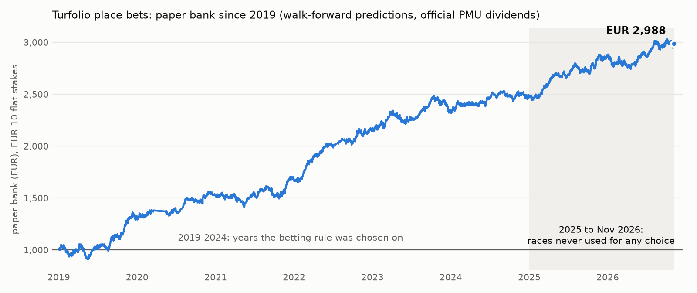

<div align="center">

# 🏇 Turfolio

### Machine learning that beat the French horse-racing place pool on 22 months of races it had never seen.

**+4.8 % ROI on 1,069 out-of-sample bets** · **69 % of bets paid out** · **€1,000 → €1,516 on paper, €10 a bet**

[](LICENSE)


**One line to install. One command for today's bets.**

</div>

<picture>
  <source media="(prefers-color-scheme: dark)" srcset="docs/bank_dark.png">
  
</picture>

Every point on that curve is a real PMU race, bet 30 minutes before the off by a model trained only on earlier years, paid at PMU's
**official** dividend. The shaded part (2025 → Nov 2026) is races that nothing in the project ever saw before the rule was frozen.

## Get today's bets

**macOS / Linux**
```sh
curl -LsSf https://raw.githubusercontent.com/SolvAI/turfolio/main/install.sh | sh
cd turfolio && ./turfolio bets --watch
```

**Windows** (PowerShell)
```powershell
powershell -ExecutionPolicy ByPass -c "irm https://raw.githubusercontent.com/SolvAI/turfolio/main/install.ps1 | iex"
cd turfolio; .\turfolio bets --watch
```

The installer brings its own Python, the dependencies and the trained model. It then builds 12 years of PMU history (157,000 races,
2 million runners) once, which takes 20–40 minutes. It needs a machine with 32 GB of RAM, but no GPU, no account and no API key.

`--watch` stays on all afternoon. PMU fixes each race's reference odds 30 minutes before the start. At that moment Turfolio
scores the field, and if a horse qualifies it prints the bet and logs it to `bets.csv`:

```text
$ ./turfolio bets --watch
Turfolio  Saturday 07 November 2026  - v3 model, place bets in PMU's main pool
39 French races. A race's bets appear 30 min before its start, when PMU fixes the reference odds.

... waiting for R7C4 MONT DE MARSAN: odds at 15:00 Paris time, 17 races to go. Ctrl+C to stop.
```

Any past day can be replayed with its official results. This is the real replay of 6 November 2026, the first day after the
shipped model's training data ends:

```text
$ ./turfolio bets 2026-11-06
13:25  R2C5   FONTAINEBLEAU    PRIX DU DEBUCHER                       9 runners
   BET  #1  Proud Lucy                place  64%  est. payout 1.75  edge +13%   stake EUR 10.00   PLACED, paid 1.40

16:55  R4C4   DEAUVILLE        PRIX DE LA PIGEONNIERE                 13 runners
   BET  #5  D'Artagnan                place  62%  est. payout 1.78  edge +10%   stake EUR 10.00   unplaced

Replay 2026-11-06: 2 bets, 1 placed, profit EUR -6.00 (-30.0% on EUR 20.00 staked)
```
<sub>A losing day, shown as it came out. A single day is noise; the edge only shows over hundreds of bets.</sub>

| Command | What it does |
|---|---|
| `turfolio bets` | Today's bets so far, plus when the next ones come |
| `turfolio bets --watch` | Live mode: each bet is printed the minute it exists |
| `turfolio bets 2026-11-06` | Replay any past day with its official results (out-of-sample from 2026-11-06 on; earlier days are in the training data) |
| `turfolio bank` | Settles your logged paper bets with PMU's dividends and shows your bank |
| `turfolio verify` | Recomputes the whole out-of-sample record above from the shipped predictions, so you don't have to trust this README |

Bets are *simple placé* (place) bets in PMU's main pool. The horse has to finish in the first three, or the first two with 4–7 runners.
That's about 2 bets per race day.

## Why it works

1. **It reads form better than the crowd does.** Gradient boosting over 187 pre-race features, Plackett–Luce ratings of every horse,
   driver and trainer, and two neural networks that read each horse's last 20 races. They pick winners better than PMU's own odds
   30 minutes before the off: winner log-loss 1.914 vs 1.984 on 5,488 races it never saw.
2. **It knows what the place pool will pay.** A place-pool model estimates each horse's place dividend from the win odds, because
   place payouts follow how the money is spread, not the true chances.
3. **It bets only where the two disagree.** Rule B: the horse has a ≥ 60 % chance to place, and expected payout × probability beats
   the stake by 10 % or more. The typical bet is a horse the pool prices at about 49 % to place that places 69 % of the time.

## The record

Flat €10 stakes, paid at PMU's official *simple placé* dividends. Walk-forward: each year is predicted by models trained only on
the years before it.

| Period | Bets | Paid out | ROI | 95 % CI |
|---|---:|---:|---:|---|
| 2019–2024 (the years the rule was chosen on) | 2,711 | 67 % | +5.4 % | in-sample for the rule |
| **Hold-out** 2025-01 → 2026-05-05 | 749 | 69 % | **+4.3 %** | −0.7 % to +9.3 % |
| **Fresh window** 2026-05-06 → 11-05, rule written down before any of it existed | 320 | 69 % | **+6.1 %** | −1.3 % to +13.8 % |
| **All out-of-sample** | **1,069** | **69 %** | **+4.8 %** | **+0.8 % to +9.0 %** |

- The rule was positive in every period it was ever run on, and retraining the whole pipeline moved its hold-out result by 0.02 points.
- Paper bank, €10 flat: **€1,000 → €1,516** over the 22 out-of-sample months, and €1,000 → €1,196 on the fresh window alone.
  `turfolio verify` prints these numbers from the shipped predictions in a second.
- Your own €10 slightly lowers the dividend you're paid. With that included, all 1,069 bets return +4.6 %. The pools are deep:
  a median €22,800 is already on each horse it backs, so even €50 stakes still return +4.0 %.

<details>
<summary><b>Winner-prediction accuracy (click)</b></summary>

Winner log-loss (lower is better) and top-pick hit rate, 95 % CIs by bootstrap over race days. "30-min market" means PMU's
reference odds 30 minutes before the off, margin removed.

| | Hold-out 2025-01 → 2026-05-05 (13,760 races) | Fresh window 2026-05-06 → 11-05 (5,488 races) |
|---|---|---|
| 30-min market | 2.023 · top pick 30.4 % | 1.984 · 30.3 % |
| Model without any odds | 1.980, **−0.043** [−0.051, −0.035] | 1.942, **−0.042** [−0.056, −0.029] |
| Model + 30-min odds | 1.952, **−0.071** [−0.076, −0.066] · 31.1 % | 1.914, **−0.071** [−0.079, −0.062] · 31.8 % |
| Final market (known only at the off) | 1.932 · 33.0 % | 1.884 · 33.5 % |
| Model + final odds | 1.915, **−0.017** vs final | 1.868, **−0.015** vs final |

</details>

---

## ⚠️ Read this before you bet a real euro

- **Paper results only.** Every number here comes from historical races. Nothing was bet with real money.
- **The edge is small and noisy.** That's about +€0.50 per €10 bet, while a single bet swings ±60 %. The fresh window alone (320 bets)
  is not proof: its interval includes zero. Only the pooled 1,069 bets clear zero, and only just. Telling +5 % apart from 0 with
  certainty would take about 3,000–4,000 more bets.
- **Small money.** At ~2 bets a day and €10 a bet, the expected profit is about €1 a day. It scales with the stake, not with
  the number of bets.
- **The market is getting sharper.** Late money moves the odds more every year. Winners shorten by 7 % between the 30-minute and final
  odds in 2023, and by 12 % in mid-2026. An edge measured on the past can shrink.
- **PMU changes things.** The win pool's margin dropped about one point in the week of 2025-09-29. In October 2026 the dividend labels
  changed, and the code handles both.
- **The model ages.** The shipped weights are trained on races up to 2026-11-05. Retraining (`run_all.sh`, a few hours on one GPU) once a year is wise.
- Paper-trade first. `turfolio bank` keeps the score for you. Gambling involves risk; in France, help is available at
  Joueurs Info Service, 09 74 75 13 13.

## What did not work

Many other strategies were tested with the same protocol and dropped. The short version:

- **Backing the winner.** Every win-bet rule lost money on fresh data, the most confident picks included (−13 %): the favourite's price
  already reflects its chances.
- **Final odds.** The model beats them (−0.015 log-loss), but they exist only at the off. Even the price one minute before is clearly worse.
- **Combination bets** (couplé, trio). PMU's combination pools are sharper than the model.
- **Hong Kong** (1979–2018). Better fundamentals, but no edge over the market there.

Details are in `results/REPORT.md` and `docs/research_log.md`.

## How it was tested

- **Data.** PMU races 2014-01 → 2026-05 from the Hugging Face archive `annaelmoussa/horse-racing-france`. Races after that come from
  PMU's public API (`src/fr_fresh.py`) in the archive's exact format (checked field by field on two overlapping weeks).
- **No leakage.** Every feature uses only earlier races, and career figures are as of the race. The model that never sees the race's
  odds (`p_fundamental`) is fitted first. Odds enter only in a stack on top.
- **Walk-forward.** To predict year Y, everything is trained on the years before Y.
- **Pre-registration.** Every rule was chosen on data up to 2024. The 2025-01 → 2026-05 hold-out was looked at once per rule. Then a
  fresh 6-month window was downloaded after the rules were frozen and written down (`results/*_preregistration.json`), and run once.
- **Model (v3).** LightGBM with Plackett–Luce ratings, plus two neural networks (attention over each horse's last 20 starts and its form
  string, a transformer over the field, 4 seeds each), blended by conditional logit. The end model stacks the 30-min odds (conditional
  logit + residual LightGBM). Place probabilities come from stage-2/3 order models, and expected payouts from a place-pool model fitted on 2019–2024.

## For developers

- `turfolio.py` is the command-line app. `src/fr_v3_final.py` trains and runs the shipped model (`models/v3/`, 34 MB: LightGBM, 8 network
  checkpoints, blend, stack and place models, manifest).
- `predictions/walkforward_predictions.parquet` holds the out-of-sample predictions for every race 2018 → 2026-11-05 (model outputs and
  race keys only).
- `run_all.sh` reruns the full research pipeline from the archive (a few hours on one RTX 4090). `fresh/run_fresh.sh` reruns the
  fresh-window test, and `fresh/README.md` has every fresh-window number.
- The project's working name was HorseCash, which is the name logs and `docs/research_log.md` use.
- Hardware: any 64-bit Windows, macOS or Linux machine with **32 GB of RAM** (each day's history build peaks at about 23 GB for 2 minutes). No GPU.

Sibling project: [UFCash](https://github.com/SolvAI/ufcash), with UFC value bets at the opening line (+24 % on 226 hold-out bets).

## License and data

Code and model weights are MIT (see `LICENSE`). **No data is included**: the installer downloads it from its sources, each under its own terms.
- [annaelmoussa/horse-racing-france](https://huggingface.co/datasets/annaelmoussa/horse-racing-france) (license "other"), the PMU archive.
- PMU's public JSON API (programmes, odds and dividends).
- Research-only scripts: Canalturf (`src/fr_canalturf.py`, whose terms art. 7 claim rights over its database: personal research only),
  [SlyZouuu/turf-data](https://github.com/SlyZouuu/turf-data) (minute-level odds, no license, `src/fr_nearoff.py`), and Hong Kong from
  [eprochasson/horserace_data](https://github.com/eprochasson/horserace_data) (`src/hk_*.py`).

Not affiliated with PMU. Not betting advice.
